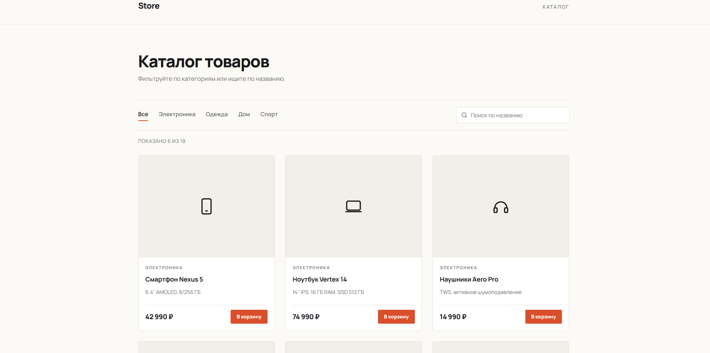
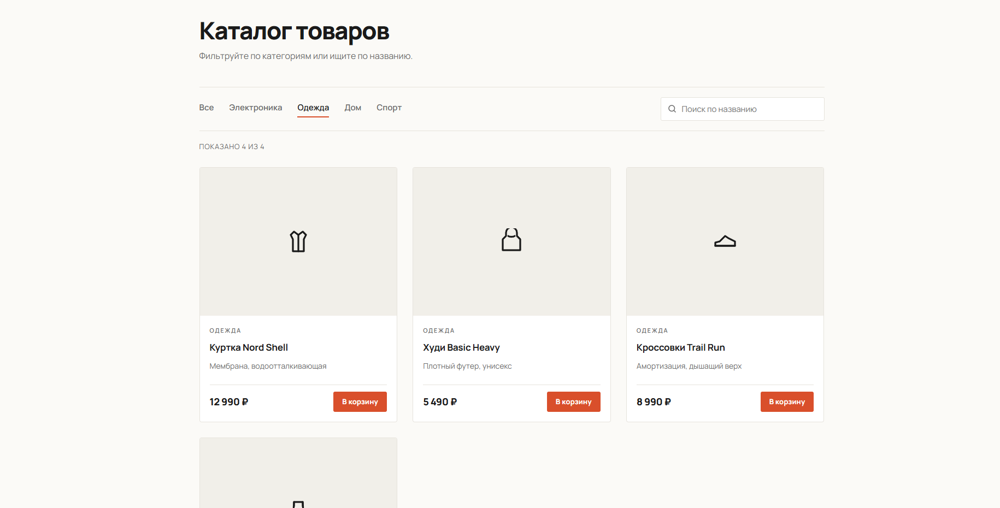
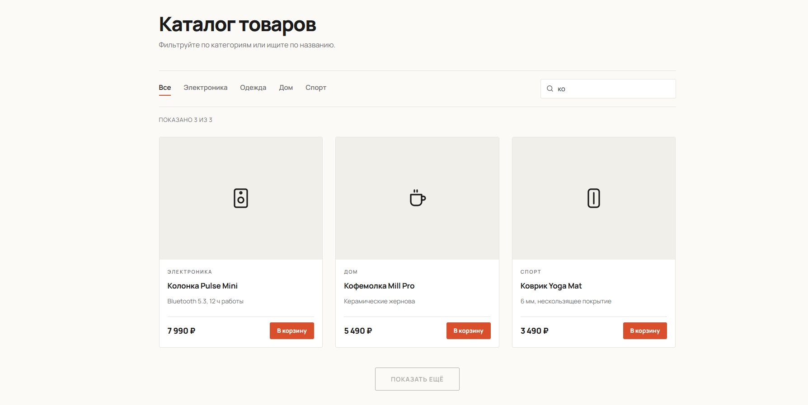
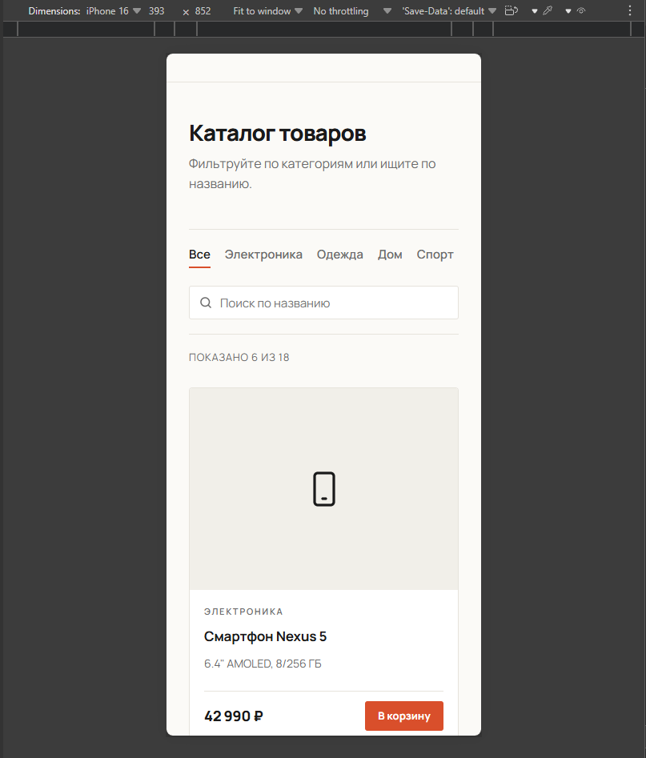

# Каталог товаров

Страница каталога с фильтрами по категориям, поиском по названию
и подгрузкой товаров порциями. Данные хранятся в JS-массиве, бэкенд не требуется.

## Стек

- HTML5 (семантическая вёрстка)
- CSS3 (Flexbox, Grid, CSS-переменные, медиазапросы)
- JavaScript (ES6+, работа с DOM, фильтрация и поиск по массиву)

## Деплой

[Открыть сайт](https://vir010.github.io/catalog-tech-store/)

## Как запустить локально

1. Склонировать репозиторий:

   ```
   git clone https://github.com/Vir010/catalog-tech-store.git
   ```

2. Открыть `index.html` в браузере или запустить Live Server в VS Code.

## Функциональность

- Сетка карточек товаров (данные — массив в JS).
- Фильтры по категориям: Все / Электроника / Одежда / Дом / Спорт.
- Поиск по названию с мгновенной фильтрацией.
- Пагинация «Показать ещё» — по 6 товаров за раз.
- Пустое состояние при отсутствии результатов.
- Адаптив: 3 / 2 / 1 колонка.

## Скриншоты




